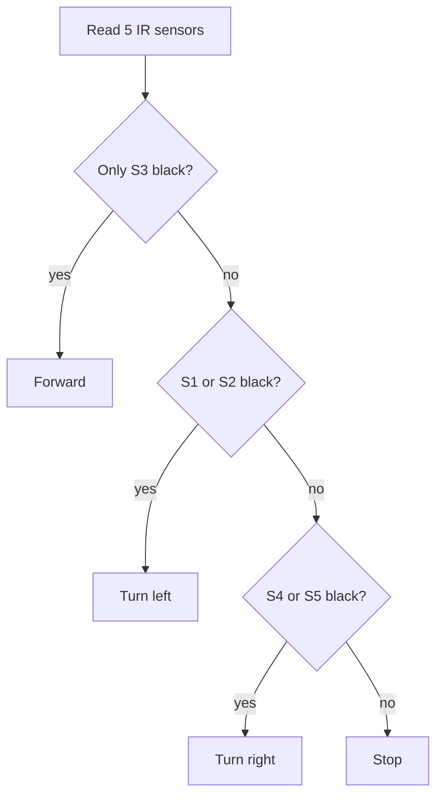

# Line Following Robot

An Arduino robot that uses a five-sensor infrared array to follow a black line.


## Overview

This is an Arduino and infrared-sensor based robot that follows a black line. Five IR sensors read the surface under the robot, each reading is compared with a threshold to decide whether it sees black or white, and a dual H-bridge motor driver steers the two drive motors to keep the line under the centre sensor.

## Features

- Five analog IR sensors for line detection
- Adjustable black/white threshold (default `500`)
- Differential drive with PWM speed control via the motor driver enable pins
- Movement modes: forward, turn left, turn right, stop
- Stops the motors when the line is lost
- Live sensor states printed to the Serial Monitor (9600 baud)

## Hardware

| Component | Purpose |
|---|---|
| Arduino board (e.g. Uno / Nano) | Main controller |
| 5-channel IR sensor array (or 5 IR sensors) | Detects the black line |
| Dual H-bridge motor driver (e.g. L298N) | Drives the two motors |
| 2 × DC gear motor + wheels | Differential drive |
| Chassis, caster wheel, battery pack | Robot base and power |

## Pin Connections

| Arduino Pin | Connected To |
|---|---|
| D9 (PWM) | Motor driver ENA (left motor speed) |
| D10 (PWM) | Motor driver ENB (right motor speed) |
| D7 | Motor driver IN1 |
| D8 | Motor driver IN2 |
| D5 | Motor driver IN3 |
| D6 | Motor driver IN4 |
| A0 | IR sensor 1 (far left) |
| A1 | IR sensor 2 |
| A2 | IR sensor 3 (centre) |
| A3 | IR sensor 4 |
| A4 | IR sensor 5 (far right) |
| GND | Common ground |

## How It Works

Each loop reads all five sensors, treats a value below the threshold as black, and chooses a movement:

| Sensor condition | Action |
|---|---|
| Only the centre sensor (S3) sees black | Move forward (both motors at PWM 150) |
| S1 or S2 sees black | Turn left (left motor reverse at 120, right forward at 150) |
| S4 or S5 sees black | Turn right (left forward at 150, right reverse at 120) |
| Anything else | Stop |



## Getting Started

1. Install the [Arduino IDE](https://www.arduino.cc/en/software). No extra libraries are needed.
2. Open `line_following_robot.ino`. The Arduino IDE expects a sketch to be inside a folder of the same name, so it may offer to create a `line_following_robot` folder for it.
3. Select your board under **Tools → Board** and the correct **Port**, then click **Upload**.
4. Place the robot on the track and open the Serial Monitor at **9600 baud** to check the sensor readings (`1` = black).
5. If the robot does not detect the line reliably, adjust `threshold` in the sketch to suit your sensors and surface.

## Project Structure

```
line-following/
├── line_following_robot.ino   # Line follower sketch
├── LICENSE
└── README.md
```

## Future Improvements

- Replace the rule-based steering with a PID controller using a weighted sensor position
- Add a search behaviour to find the line again instead of stopping
- Add an automatic sensor calibration routine at startup
- Handle junctions and sharp turns (e.g. all sensors black)

## Author

**Swayam Khantwal** – [GitHub @Swayam7024](https://github.com/Swayam7024)

## License

This project is licensed under the MIT License – see the [LICENSE](LICENSE) file for details.
